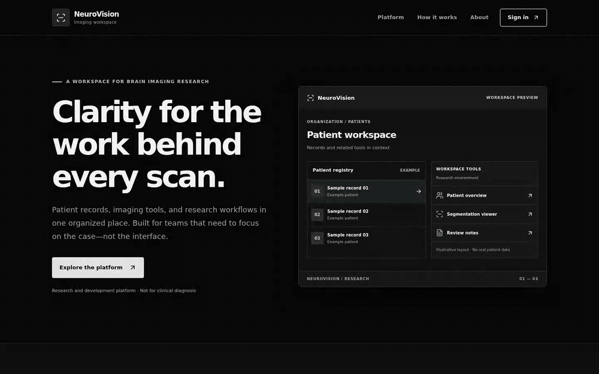
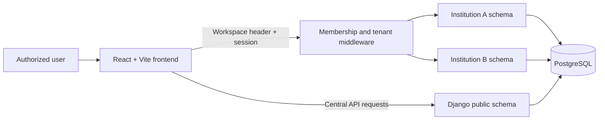

<p align="center">
  
</p>

<h1 align="center">NeuroVision</h1>

<p align="center">
  A tenant-isolated workspace for organizing brain-imaging research workflows.
</p>

<p align="center">
  <a href="https://github.com/Aryan-coder-student/NeuroVision-BHPC/actions/workflows/backend-ci.yml"></a>
  <a href="https://github.com/Aryan-coder-student/NeuroVision-BHPC/actions/workflows/frontend-ci.yml"></a>
  <a href="https://www.python.org/"></a>
  <a href="https://react.dev/"></a>
  <a href="https://www.postgresql.org/"></a>
</p>

> **Research use only.** NeuroVision is not a certified medical device and must not be used to make clinical decisions.

<p align="center"><sub>Local Docker preview with illustrative sample records only.</sub></p>

## Overview

NeuroVision brings patient records, organization-scoped access, and brain-imaging research tools into one workspace. It is designed for teams that need patient context to remain visible while moving between registry, segmentation, visual question answering, history, and reporting workflows.

The platform uses schema-based multi-tenancy: each institution has an isolated database schema, and every tenant request is checked against the authenticated user's active membership before data is accessed.

## Platform capabilities

| Area | Included today |
| --- | --- |
| Identity and access | Registration, email OTP verification, cookie-based JWT authentication, CSRF protection, and workspace membership checks |
| Organization workspaces | Institution selection, tenant-aware routing, role-sensitive patient access, and cross-workspace patient discovery for authorized users |
| Patient registry | Patient registration, generated identifiers, date-of-birth validation, identity-grant workflow, pagination, search, and tenant-scoped records |
| Imaging workspace | Patient-scoped segmentation viewer, visual question answering, history, reports, model registry, data contribution, and feedback surfaces |
| Delivery | Docker development stack, Render blueprint, and GitHub Actions checks for backend lint/tests, frontend verification, and container security |

## Architecture



| Layer | Technology | Responsibility |
| --- | --- | --- |
| Frontend | React 19, Vite, React Router, NiiVue | Browser application, workspace navigation, and imaging interfaces |
| API | Django 6, Django REST Framework | Authentication, API endpoints, patient workflows, and validation |
| Tenancy | django-tenants + PostgreSQL schemas | Institution isolation and member-authorized tenant resolution |
| Data | PostgreSQL 16 | Public identity data and isolated institution data |
| Delivery | Docker, Render, Vercel-compatible static build | Local services and production deployment paths |

## Repository layout

```text
.
├── backend/
│   ├── platform_api/
│   │   ├── clinical/       # Patient records and identity-grant workflows
│   │   ├── tenant/         # Institutions, memberships, and tenant resolution
│   │   ├── users/          # Registration, OTP, and authentication
│   │   └── platform_api/   # Django settings and API routing
│   └── Dockerfile
├── frontend/
│   ├── src/components/     # Shared application shell and patient context
│   ├── src/pages/          # Research workspace screens
│   └── src/services/       # API and tenant URL boundaries
├── docker-compose.yml
├── render.yaml
└── UX-CONTRACT.md          # Product and interaction constraints
```

## Quick start

### Prerequisites

- Docker Desktop and Docker Compose, or:
  - Python 3.13 with [uv](https://docs.astral.sh/uv/)
  - Node.js 22 and npm
  - PostgreSQL 16

### 1. Configure the environment

Create the Docker Compose environment file from the tracked example:

```bash
cp backend/.env.example backend/.env
```

For Docker Compose, use this local database URL in `backend/.env`:

```env
DATABASE_URL=postgresql://postgres:postgres@db:5432/neurovision
```

Keep the remaining values from the example, and replace development secrets before any shared deployment. The frontend defaults to the local central API; copy its example if you need to override it:

```bash
cp frontend/.env.example frontend/.env
```

For a direct Django run instead of Docker Compose, the backend settings loader reads its environment file from `backend/platform_api/.env`:

```bash
cp backend/.env.example backend/platform_api/.env
```

### 2. Start the stack

```bash
docker compose up --build
```

The application will be available at:

- Frontend: `http://localtest.me:5174`
- API: `http://localtest.me:8000/api/v1`
- MailHog inbox: `http://localhost:8025`

The backend entrypoint applies tenant migrations, collects static files, and initializes the public platform tenant. `localtest.me` resolves to `127.0.0.1`, allowing local wildcard subdomain and cookie behavior to match the tenant model.

To stop the services while retaining the database volume:

```bash
docker compose down
```

### Run without Docker

Set `DATABASE_URL` in `backend/.env` to a running local PostgreSQL database, then install and initialize each application:

```bash
./setup.sh
```

Run the backend and frontend in separate terminals:

```bash
cd backend/platform_api
uv run python manage.py runserver
```

```bash
cd frontend
npm run dev
```

## Development commands

Run these from the indicated directory.

| Area | Command | Purpose |
| --- | --- | --- |
| Backend | `uvx ruff==0.15.12 check .` | Lint Python source |
| Backend | `uv run python manage.py test users.auth.tests tenant.tests clinical.tests --noinput` | Run backend test suite |
| Frontend | `npm run lint` | Lint frontend source |
| Frontend | `npm test` | Run frontend unit tests |
| Frontend | `npm run build` | Create the production bundle |

## Design patterns and engineering boundaries

NeuroVision is a modular monolith with explicit boundaries around identity, tenancy, clinical records, and browser state. The project favors small, visible patterns over framework-heavy abstractions.

| Pattern | Where it is applied | Why it matters |
| --- | --- | --- |
| Feature-oriented modular monolith | `users`, `tenant`, `clinical`, and patient-identity modules | Keeps related models, API rules, and tests together while retaining a single deployable service. |
| Application service layer | `users.auth.service.UserService` and `clinical.services` | Moves multi-step business workflows out of views so they are testable, transactional where required, and reusable. |
| Read/write representation split (CQRS-lite) | `PatientReadSerializer`, `PatientWriteSerializer`, and `PatientRegistrationSerializer` | Separates API output from allowed mutations; generated identifiers, identity links, and timestamps cannot be silently written by clients. |
| Schema-per-tenant isolation | `django-tenants` institutions and PostgreSQL schemas | Keeps each institution's clinical records physically separated at the database layer. |
| Policy-enforcement middleware | `WorkspaceTenantMiddleware` | Authenticates the request and verifies active workspace membership before switching PostgreSQL tenant context. |
| Compensating transaction | Patient registration and identity-grant workflow | Removes the newly created patient and public identity-grant artifacts if the OTP grant cannot be started, avoiding partial onboarding state. |
| Explicit client state ownership | `AuthProvider` for session/workspace state and `PatientWorkspace` for patient scope | Gives each state concern one owner and prevents a selected workspace or patient from being inferred implicitly. |
| UTC storage and presentation policy | Django-aware timestamps; patient calendar rules | Stores instants in UTC and keeps date-only patient fields as calendar values, with user-facing date presentation following the documented India timezone convention. |

### Segmentation sample walkthrough

From a patient workspace, open **Segmentation**, leave **BraTS 2021 sample** selected,
and press **Run AI Segmentation**. The bundled T1CE MRI and reference segmentation
mask load in NiiVue. Use **MRI + mask**, **Original MRI**, **Segmentation mask**, or
**3D overlay** to inspect the same volume without fetching it again.

This is a research reference preview, **not AI inference**: no model prediction
is made, no patient study is uploaded, and no patient result or report is saved.
The separate **Patient study (experimental)** option still requires a locally
running Flask `/predict` service, but the browser now reaches it only through
the tenant-authorized Django inference API.

### Separate inference capability modules

Backend inference modules live in `backend/platform_api/ai_providers/`:

- `segmentation/` owns the MONAI 3D UNet request contract, serializer, adapter, and view.
- `vqa/` owns the BLIP question + image contract, serializer, adapter, and view.

Only model catalog/selection, transport, configuration, tenant permissions,
response formatting and provider error handling are shared. Both task views
inherit a single patient-scoped request lifecycle from `PatientInferenceView`.
No second provider service or job queue is introduced by this refactor.

### AI provider registry

The Django provider registry exposes the existing MONAI 3D UNet and fine-tuned BLIP models through patient-scoped endpoints. The catalog reports configuration and version metadata only; it does not claim that a provider is live until an inference request succeeds.

| Pattern | Implementation | Boundary it protects |
| --- | --- | --- |
| Provider interfaces | `SegmentationProvider` and `VQAProvider` accept validated capability-specific requests. | Keeps Django views and React independent of inference transports. |
| Provider adapters | `MonaiSegmentationAdapter` preserves the Flask contract; `BlipVQAAdapter` preserves the FastAPI multipart contract. | Contains provider URLs, tokens, timeouts, and vendor payloads server-side. |
| Model catalog and registry | The settings-backed catalog maps stable model IDs to versions and configured adapters. | Makes future providers additive without exposing invented models or browser-selected endpoints. |

Inference responses are returned to the caller but are not persisted as clinical records. This change does not add MRI upload, report generation, background jobs, Celery, Redis, or another service.

## API and tenant model

The central API is exposed under `/api/v1`:

```text
/api/v1/auth/             Authentication, OTP, profile, and CSRF endpoints
/api/v1/workspaces/       Institution discovery and management
/api/v1/my-patients/      Authorized cross-workspace patient discovery
/api/v1/tenant/context/   Current workspace context
/api/v1/tenant/patients/  Tenant-scoped patient records and identity grants
/api/v1/tenant/models/    Configured model catalog and version metadata
/api/v1/tenant/patients/:id/inference/  Patient-authorized inference proxy
```

Tenant-scoped routes require an authenticated user and an `X-Workspace-Id` that resolves to one of that user's active memberships. Requests that are unauthenticated, missing workspace context, or target an unauthorized workspace are rejected before tenant data is selected.

## Deployment

`render.yaml` provides a Render blueprint for the Dockerized Django backend and static Vite frontend. Set deployment secrets in the hosting provider rather than committing them:

- `DATABASE_URL`
- `SECRET_KEY`
- `ENCRYPTION_KEY`
- `TENANT_BASE_DOMAIN`
- `VITE_API_URL`
- `MONAI_SEGMENTATION_BASE_URL`, timeout, optional API token, and model version
- `BLIP_VQA_BASE_URL`, timeout, optional API token, and model version

The frontend can also be deployed as a Vite static application on Vercel-compatible platforms. Use `frontend` as the project root, `npm run build` as the build command, and `dist` as the output directory.

## Security and data boundaries

- Institution data is separated by PostgreSQL schema.
- Tenant selection is constrained by authenticated, active membership.
- Authentication uses HTTP-only cookies with CSRF enforcement for unsafe requests.
- Patient identity linking is an explicit OTP-verified flow.
- Production deployments must use provider-managed secrets, TLS, and a production database; development values in `.env.example` are not safe defaults for production.

Report security issues privately. Do not include credentials, patient data, or sensitive reproduction material in public issues.

## Project status

NeuroVision is actively evolving as a brain-imaging research platform. The codebase includes research-facing imaging workflows alongside core patient and workspace operations; persistent clinical reporting is still in development.

## License

No license file is currently included in this repository. Add an explicit license before redistributing or accepting external contributions under defined terms.
